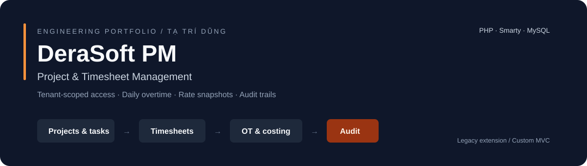
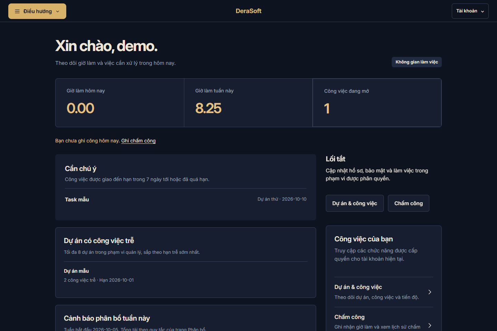
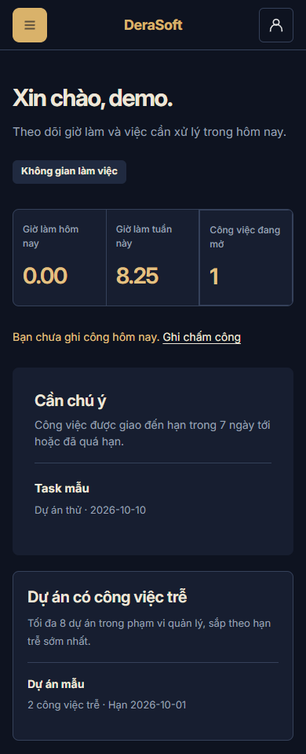

<p align="center">
  
</p>

<p align="center">
  
  
  
  
</p>

# DeraSoft PM

**Delivery update - 16 Oct 2026:** The user accepted completion of the ten agreed functional areas and reported successful upload of the Midnight Gold interface. Latest local verification: **66 regression scripts, 47 browser suites, 157 PM/HR controller HTTP fixture cases and 14 native-form contracts passed**; contents of 96 local tables remained unchanged. The interface uses self-hosted Inter, dark surfaces, gold actions and reduced-motion support. Cron reminders are additional scope; advanced throttle012 SQL/concurrency verification remains a separate follow-up. This is acceptance of the agreed scope, not a claim of exhaustive UAT, zero defects or production load testing. See [requirements and limits](docs/PM_TEN_REQUIREMENTS_STATUS_20261016.md), [latest test report](docs/PM_UI_BE_ACTION_RETEST_20261016.md) and [bug-prevention lessons](docs/BUG_LESSONS.md).

**Project & timesheet management built by extending an existing PHP application.**

DeraSoft PM connects workforce management, projects, tasks and time tracking in a tenant-scoped workspace for Admin, Project Manager, HR and employees. It preserves the existing DeraSoft architecture while adding prepared queries, access boundaries and auditable business operations.

**Author:** [Tạ Trí Dũng](https://github.com/tridung-ta) · **Focus:** backend development, business rules and legacy integration.

> **Project status:** Completed within the scope accepted by the user on 16 Oct 2026. Source, handoff documentation and reusable lessons are maintained together; historical verification gaps remain documented.

## What the application does

| Area | Delivered functionality |
| --- | --- |
| Authentication & access | Legacy password upgrade, secure sessions, four roles and tenant-scoped permissions |
| Workforce | User and department management, multiple roles and effective hourly rates |
| Projects & tasks | Project members, task assignment, priorities, deadlines and four-column Kanban |
| Timesheets | Task/date/fixed-shift entries, configurable daily total-hours limits up to 24 hours and recalculation after changes |
| Overtime & costing | Daily OT across projects, stored rate snapshots and MySQL DECIMAL cost calculation |
| Automatic locking | Three calendar days to edit; Admin corrections after locking receive separate audit actions |
| Audit viewer | Tenant/project/department access scopes, financial-field redaction, filters and pagination |
| Cost dashboard | Actual/estimated/budget comparisons, mixed-currency guards, charts and polling |
| Resource allocation | Weekly grid, capacity overrides, overbooking/overlap warnings and suggestions |
| Reports & Excel | Weekly hours/OT/task statistics, scoped cost groups, XLSX exports and resumable personnel import |

Timesheet approval is intentionally deferred. Phase 5 has no Submitted/Approved/Rejected workflow. Reports/XLSX and personnel import are locally implemented.

**Locally verified Phase 6:** cost dashboard with stored actual costs, DECIMAL estimates, mixed-currency warnings (no invalid totals), Admin/PM project scopes, pinned local Chart.js and polling every 60 seconds while the tab is visible. Service, HTTP, template and synthetic-browser acceptance passed.

**Locally verified Phase 7:** weekly allocations, time-bound daily/weekly capacity overrides, half-open interval overlap warnings, scoped workload totals and capacity suggestions. Allocation/audit writes are transactional; sorted user/day mutexes were exercised with two MySQL connections. Suggestions never change assignments automatically. Service, HTTP, template and synthetic-browser checks passed; detailed manual acceptance remains separately recorded.

## Engineering highlights

- **Tenant isolation:** new business queries and access checks use the session's `store_id`.
- **Consistent daily OT:** a unique user/day ledger is locked before writes; editing, moving or hiding an entry recalculates the affected days.
- **Historical costing:** each timesheet stores its rate snapshot and cost; editing the same date preserves the original rate.
- **Auditable transactions:** the business write, affected-row recalculation and JSON audit records commit or roll back together.
- **Safe legacy extension:** additive migrations, soft deletes and compatibility paths preserve existing functionality.
- **Server-side enforcement:** ownership, role permissions, CSRF checks and the edit window accompany escaped Smarty output.

## Architecture

```text
modules/admin/         Controllers and permission / CSRF checks
classes/dao/           Prepared data access for new PM modules
classes/services/      Business rules, transactions, OT and rate resolution
templates/admin/       Smarty views
database/migrations/   Versioned additive schema changes
database/seeds/        Role and permission mappings
tests/                 Local service and template smoke checks
docs/                  Audit, plans, schema and verification records
```

**Stack:** plain PHP · Smarty · MySQL (PM InnoDB tables; legacy dc_users remains MyISAM) · custom MVC · embedded PhpSpreadsheet.

## Explore the work

- [Latest implementation](https://github.com/tridung-ta/derasoft-pm/tree/main)
- [Progress and commands actually run](https://github.com/tridung-ta/derasoft-pm/blob/main/docs/PROGRESS.md)
- [Current requirements coverage](https://github.com/tridung-ta/derasoft-pm/blob/main/docs/PHASE11_REQUIREMENTS.md)
- [Architecture and security audit](https://github.com/tridung-ta/derasoft-pm/blob/main/docs/AUDIT.md)
- [Database schema](https://github.com/tridung-ta/derasoft-pm/blob/main/docs/DB_SCHEMA.md)
- [Portfolio / CV summary](docs/PORTFOLIO.md)

## Local verification

Current commands from the repository root (PowerShell; prepare bundled PHP locally):

```powershell
powershell -ExecutionPolicy Bypass -File tests/pm_workspace_verify.ps1
python tests/pm_ui_review_contract.py
powershell -ExecutionPolicy Bypass -File tests/pm_regression.ps1
python docs/learning/sync_memory.py --check
```

Full regression requires the guarded, backed-up `derasoft_pm_local` database. The runner does not apply migrations. Browser fixtures and intercepted POSTs are separate from actual controller/DAO HTTP tests. See the latest report for preview setup and coverage limits.

Use PHP 8.3 with the required extensions and a backed-up local database. See the [environment baseline](https://github.com/tridung-ta/derasoft-pm/blob/main/docs/BASELINE.md) and [migration conventions](database/migrations/README.md) before setup. Environment configuration and license files are supplied separately; the public repository is not a one-command installation package.

After checking out main and preparing the local schema, representative checks are:

```sh
php tests/pm_timesheets_smoke.php
php tests/pm_timesheet_window_smoke.php
php tests/pm_audit_smoke.php
php tests/smoke_pm_timesheets.php
php tests/smoke_pm_audit.php
```

These checks passed on the documented local environment. Database smoke fixtures use transactions/rollback or connection-local temporary mirrors for nontransactional legacy tables. Automated service/template verification does not replace browser UAT or concurrent multi-connection testing.

## Delivery and follow-up

| Scope | Status |
| --- | --- |
| Ten agreed functional areas | Implemented; accepted by the user on 16 Oct 2026 |
| Midnight Gold UI | Local regression passed; user reported successful host upload |
| Cron notifications | Additional scope; reminders implemented; advanced throttle012 evidence tracked separately |
| Documentation and lessons | Architecture, run/test guidance, handoff, requirement matrix and 32 project-scoped lessons retained |
| Remaining verification | Real-account PM/HR login, full manual keyboard/zoom/CSP/state coverage, actual session expiry and rate-write concurrency are not claimed as fully verified |

## Interface preview

Rendered application templates with synthetic demonstration data. These are not production screenshots or evidence of live persistence; security-probe strings are replaced with readable sample names for presentation.





## Tiếng Việt

Hệ thống quản lý dự án và chấm công phát triển trên nền DeraSoft hiện có, không viết lại framework. Điểm chính gồm phân quyền theo tenant, quản lý nhân sự/dự án/task, tính OT theo tổng giờ ngày, snapshot đơn giá và audit log trong transaction. Chấm công được sửa/xóa trong ba ngày lịch tính từ ngày làm việc; Admin sửa sau khóa có audit riêng.

Accepted delivery: all ten groups completed within the agreed scope on 16 Oct 2026; user-reported UI upload successful. Cron is additional scope. Configuration, uploads, dumps, sessions and logs remain excluded from Git. Acceptance does not erase the specific technical verification limits documented above.

Local Phase 8 import supports Admin-only XLSX preview/staging, per-row Apply results,
duplicate-key handling and resume with a connection-owned batch lock. The approved tenant
email UNIQUE index preserves the legacy MyISAM engine. New accounts remain inactive until
Admin provisions a password and explicitly activates them. MyISAM writes and PM journal
writes are not one atomic transaction. Successful Apply/crash scenarios use a temporary
transactional user mirror; native duplicate rejection is checked on the actual local table.

Run the current local regression suite with `./tests/pm_regression.ps1` (66 scripts;
requires the documented local DB and PHP setup). This runner does not apply migrations.

Historical Phase 9 verification adds shared accessible navigation/forms/table regions, exact tenant-scoped
batch role lookup (20 role queries → 1), active-session checks, PM login/logout CSRF and
local-only CSP-compatible assets. The 41-script regression suite and synthetic browser
matrix passed. Authenticated HTTP UI coverage is Admin/Employee; PM/HR service fixtures
are distinct from authenticated UI sessions. See [verification and remaining coverage](docs/PHASE9_VERIFY.md).
EXPLAIN of 62 local query shapes is evidence of query/index selection, not a production benchmark.

Historical Phase 10 local BUILD / automated VERIFY: 41 regression scripts, authenticated
four-role browser checks and native MyISAM PHP-worker crash/resume passed on an isolated DB.
Synthetic accounts were disabled and business fixtures soft deleted; source personnel stayed unchanged.
See [verification and remaining coverage](docs/PHASE10_VERIFY.md),
[manual FileZilla deployment preparation](docs/DEPLOY_LOG.md) and
[final local UAT checklist](docs/UAT_FINAL_LOCAL.md). These are phase-specific historical
results; current delivery/acceptance status is at the top of this README.
